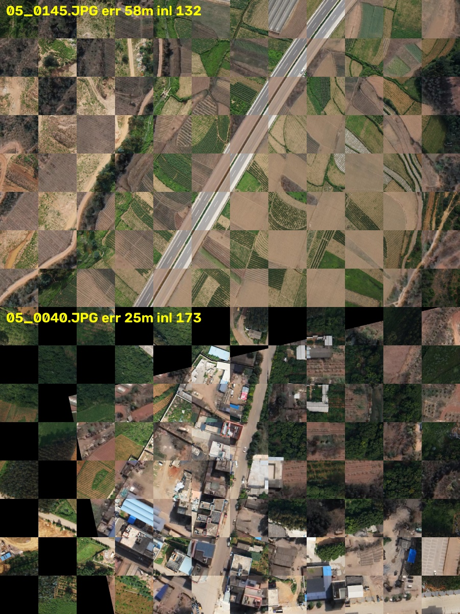

# Geo-registration: placing video on the map

Status: prototype (`src/trafficwb/georeg.py`, command `trafficwb-georeg`). Not yet in the web screens.

Every camera kind ends in the same thing: a ground homography from frame pixels to metres east and north of a
local origin, so any pixel on the road (the bottom centre of a vehicle box) becomes a latitude and longitude.
The ground is taken as flat across one frame; hills and tall buildings add errors that grow with their height.

## Drone and aircraft video

1. **First guess from flight data, when the video has it** (optional, as before). Best first: KLV frame corner
   points; then the platform position with the frame centre and field of view; then the sensor's angles relative to
   the platform; then a DJI subtitle file's position, height above take-off and gimbal angles.
2. **Frame to frame**: corners followed with pyramidal optical flow, a homography to the last keyframe, chained.
   About 6 to 11 ms a frame on 4 CPU cores at 720p and 1080p. Smooth, but it drifts.
3. **Snap to the map** every 1 to 4 seconds: the map (an orthophoto or satellite GeoTIFF the operator supplies; nothing
   is downloaded) is drawn as the camera should see it from the current estimate, and the frame is matched against
   that drawing (ALIKED features with LightGlue, ONNX; SIFT when no model pack is given). The correction is checked
   (enough inliers, no fold, no jump larger than 60% of the footprint) before it is used. In real time the match runs
   beside the tracking and is applied when ready; because the correction is metres-to-metres it stays right for
   every later frame of the same chain.
4. **No flight data**: a search over map tiles and four headings for the first fix (`locate`), given a rough scale.
   Slow (tens of seconds to minutes); then steps 2 and 3. With no map match for 5 s and flight data present, the
   flight data takes over again.

KLV moving targets (ST 0903) can be placed with the registration and compared with the positions the aircraft sent
(`targets_on_ground`): a check on both.

## Fixed surveillance cameras

Four or more points picked on a frame and on the map give the homography directly (`fit_points`). Each point's error
when it is left out of the fit is reported, and a point the others disagree with is named (`suspect`), so a wrong
click shows. `refine_with_map` then pulls the fit onto the map by matching, when the view is steep enough for the
map to look like the picture; otherwise the hand fit stands. A camera that shakes or is moved can be re-tied with the
same frame-to-frame step as drones.

## Dashcams

The lens height, pitch (from the horizon's row) and field of view give the road ahead in metres
(`DashcamGround`). The road's own motion between frames (ground-plane visual odometry) moves the car; each GPS fix
pulls the position toward it and, once the car has moved 15 m, corrects the heading and the odometry's scale
(`DashcamTrack`). Matching a dashcam to satellite imagery is not attempted: the views are too different.

## Measured (13 Nov 2026, 4-core cloud container, no GPU)

| Test | Data | Result |
|---|---|---|
| Drone photo to satellite map, learned matcher (2000 points) | UAV-VisLoc flight 05: 158 real drone photos, ~320 m up, satellite map from another season; flight-data guess with GPS 10 m, heading 5°, height 10%, gimbal 3° errors | 115 of 158 matched (73%); matched frames lie on the map to about 1–3 m by eye (picture below) |
| Same, learned matcher (1000 points) | same | 102 of 158 (65%), half the time |
| Same, SIFT | same | 0 of 158: classic features fail across seasons |
| Against the dataset's own positions | same | camera position from the registration is 20 m (median) from the logged GPS, p90 60 m; the dataset logs the drone's GPS (not the picture centre), and its lens and tilt are not given, so this is a bound on the labels as much as on the method |
| Synthetic flight with exact truth | 30 s, 30 fps, 1280x720, 150 m up, looking 60° down, over a real satellite map, with colour, blur, noise and JPEG changes | flight data alone 11.3 m median (p90 14.6); chain alone 0.3 m median, 0.7 m worst after 30 s; chain with map snaps in real time 0.13 m. Optimistic: the frames are drawn from the same map they are matched to, and the ground is perfectly flat |
| Fixed camera, points only | synthetic poles (10–30 m, 15–35° down), 3 px clicking error on the frame and 0.5 m on the map | 4 points: 1.4–2.7 m median, with bad outliers; 6 points: about 0.5–0.6 m; 10 points: 0.3–0.5 m |
| Dashcam | KITTI odometry 03 (real road video, exact poses, 559 m); a noisy 1 Hz GPS (3 m) added | GPS with odometry 2.2 m median (p90 4.2), heading 8° median; GPS alone, held between fixes, 4.6 m (p90 8.8); odometry alone drifts 84 m (15% of the distance) |
| Speed | | frame-to-frame 6–11 ms; one map match 4.2 s (learned, 2000 points), 2.0 s (1000 points), 0.14 s (SIFT). Real time at 30 fps with a map match every 2–4 s on CPU |

Not yet measured: real video with real KLV or DJI flight data (none with a matching map was reachable from here),
thermal video, and the operator's own drone clips.

## Not done yet

- Web screens: picking points for a fixed camera, choosing the map file, showing vehicles on the map.
- The learned matcher ships as a third-party ONNX export (see `docs/decisions/georeg-matcher.md`); it is not in the
  installer's model packs yet.
- A GPU path for the matcher, and heights (a terrain model) for hilly ground.
